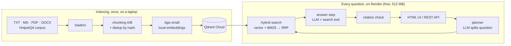

# AI Investigation Engine

A retrieval-augmented investigation system over 66,589 documents (66,581 HotpotQA paragraphs + 8 synthetic files). It splits a question into searches,
collects evidence with hybrid retrieval (vector + own BM25, merged by own Reciprocal Rank Fusion),
answers only from retrieved chunks with numbered citations, flags sources that contradict each other,
and refuses when the evidence is not there.

**Live demo:** https://investigation-engine-l74q.onrender.com (free tier: after idle it sleeps, the first request wakes it and the index loads for 1–2 minutes) · **Evaluation:** [docs/EVALUATION.md](docs/EVALUATION.md) ·
**AI usage:** [docs/AI_USAGE.md](docs/AI_USAGE.md) · **Decisions:** [docs/decisions](docs/decisions)

## How it works



1. **Planner.** The LLM turns the question into up to 3 search queries (one per hop); the original question is always searched too.
2. **Retrieval.** Each query goes to vector search (cosine, Qdrant) and to BM25 (in memory). Rankings are fused with RRF.
3. **Answer.** Chunks are labelled `C1…Cn`. The LLM must cite labels for every claim, list contradictions, or set `insufficient_evidence`. It can call the `search_documents` tool up to 2 times if evidence is missing.
4. **Verification.** Citations to labels that were never shown are dropped; an answer left without valid citations is marked unsupported.

## Requirements coverage

| Requirement | Where | Proof |
|---|---|---|
| 3+ formats, text + metadata | `app/ingest/loaders.py` (TXT, MD, PDF, DOCX) | `tests/test_loaders.py` (one test per format) |
| Two chunking strategies, compared | `app/ingest/chunking.py` | `tests/test_chunking.py`; comparison in `docs/EVALUATION.md` |
| Deduplication, add / update / delete | `app/ingest/dedup.py`, `app/ingest/pipeline.py`, `PUT/DELETE /api/documents` | `tests/test_pipeline.py`, `test_upload_list_update_delete`, `test_duplicate_upload` |
| Vector DB + embeddings | Qdrant (`app/search/vector_store.py`), bge-small via fastembed | `test_vector_search_finds_matching_chunk`, `tests/test_embeddings.py` |
| Hybrid search, own algorithm | own BM25 `app/search/bm25.py`, own RRF `app/search/hybrid.py` | `tests/test_bm25.py` (13), `tests/test_hybrid.py`; hybrid vs vector in `docs/EVALUATION.md` |
| Multi-step reasoning, multi-document answers, citations | `app/rag/planner.py`, `app/rag/answer.py` | `test_tool_call_adds_new_context`, `test_answer_with_valid_citations`, `test_invented_citation_is_dropped_and_answer_flagged` |
| Contradictions, refusal | answer JSON + validation in `app/rag/answer.py` | `test_contradictions_are_kept_with_valid_labels`, `test_model_refusal_is_respected`; eval: 4/4 contradictions, 5/5 refusals |
| LLM error handling | timeouts, retries with backoff and Retry-After, 503 to the client: `app/rag/llm.py`, `app/retry.py` | `tests/test_llm.py`, `test_llm_outage_returns_503`, `test_malformed_tool_call_falls_back_to_json_answer` |
| Tool calling | `search_documents` tool, `app/rag/tools.py` | `test_tool_call_adds_new_context`, `test_tool_rounds_are_limited` |
| Own evaluation, 40+ questions | `eval/` (44 questions, Recall@K, MRR, correctness, citation accuracy, abstention) | `tests/test_metrics.py`; results in `eval/results/`, report `docs/EVALUATION.md` |
| UI + backend | HTML + JS page served by FastAPI, one process (`app/ui/index.html`) | `tests/test_api.py` (11 tests) |
| 50,000+ documents | 66,581 HotpotQA dev paragraphs + 8 synthetic documents | `scripts/build_subset.py` stops below 50,000; live `/api/health` reports 66,589 documents |
| Deployment, persistence, secrets | Render free web service (Docker, `render.yaml`) + Qdrant Cloud; keys in Render secrets ([ADR 0008](docs/decisions/0008-render-free-512mb.md)) | live demo; `test_restart_rebuilds_state_from_the_store`; `.env` in `.gitignore` and `.dockerignore` |

## Run locally

```bash
python -m venv .venv && source .venv/bin/activate      # Python 3.11+ (the Docker image runs 3.11; tests pass on 3.13 locally). Windows: .venv\Scripts\activate
pip install -r requirements.txt
cp .env.example .env                                     # add LLM_API_KEY; QDRANT_URL empty = local storage
python -m scripts.build_subset                           # downloads HotpotQA dev from Hugging Face (~27 MB) -> data/corpus.jsonl
python -m scripts.make_synthetic_docs                    # data/synthetic: 9 files in 4 formats
python -m scripts.index_dataset --strategy paragraph --collection documents_paragraph
uvicorn app.api.main:app --port 7860                     # UI: http://localhost:7860, API docs: /docs
pytest
```

Quick try without the full corpus: `python -m scripts.index_dataset --limit 2000`.

## Evaluation

Results and analysis: [docs/EVALUATION.md](docs/EVALUATION.md) (all commands to reproduce are at its end).

```bash
python -m eval.run_eval build                      # writes eval/questions.jsonl (44 questions, seed 42)
python -m eval.run_eval run --name hybrid_paragraph --collection documents_paragraph --mode hybrid --retrieval-only
python -m eval.run_eval run --name full_qwen --collection documents_paragraph --mode hybrid --judge --sleep 4
python -m eval.run_eval compare vector_paragraph bm25_paragraph hybrid_paragraph
```

Summary (hybrid, qwen3.8-27b): Recall@10 0.921, judge 0.837, citation accuracy 0.838, 5/5 unanswerable
questions refused, 4/4 planted contradictions reported. Hybrid beats vector-only retrieval (Recall@10 0.923 vs 0.885);
the two chunking strategies tie, paragraph chunking stores half the chunks.

## Deploy (Render + Qdrant Cloud)

1. Create a free Qdrant Cloud cluster and put `QDRANT_URL`, `QDRANT_API_KEY` in `.env`.
2. Index locally, then copy the ready vectors to the cloud (no second embedding pass):
   `python -m scripts.copy_collection --collection documents_paragraph`
3. On render.com: **New → Blueprint**, pick this GitHub repository. `render.yaml` describes a free Docker web
   service; Render asks for the secrets `LLM_API_KEY`, `QDRANT_URL`, `QDRANT_API_KEY`.
4. On start the app reads all chunks from Qdrant and builds BM25 in memory, so a restart loses nothing.
   `/api/ping` answers at once; `/api/health` shows the index once it is loaded.

Why Render and not Hugging Face Spaces: Docker Spaces on the free CPU now require a paid subscription, and the app
was cut down from ~625 MB to a measured ~407 MB peak to fit Render's 512 MB ([ADR 0008](docs/decisions/0008-render-free-512mb.md)).

## API

| Method | Path | |
|---|---|---|
| GET | `/api/health` | status and index stats |
| GET | `/api/documents` | uploaded and synthetic documents (the 66k corpus paragraphs are counted in `/api/health`) |
| POST | `/api/documents` | upload a file (multipart `file`) |
| PUT | `/api/documents/{doc_id}` | new version of a document |
| DELETE | `/api/documents/{doc_id}` | remove a document and its chunks |
| POST | `/api/search` | `{"query", "k", "mode"}` raw retrieval |
| POST | `/api/ask` | `{"question", "mode"}` full investigation |

## Performance and cost

Measured on 2026-10-27 (laptop: Intel i5-10210U, 8 GB RAM; host: Render free, 512 MB).

| What | Measured |
|---|---|
| Answer time, live demo | 7–14 s per question (3 questions through the public URL); 2–4 LLM calls each: plan, answer, up to 2 search-tool rounds |
| Index load at start | ~37 s locally from Qdrant Cloud (78,006 chunks); about 1 minute on Render (503 "loading" at 19:17:47, ready at 19:18:48) |
| BM25 | build 5.5 s for 66,581 chunks; 3 searches in ~3 ms; ~40 MB as numpy CSR arrays |
| Memory | peak 407 MB with the full collection (was ~625 MB before ADR 0008) |
| Embeddings (indexing, laptop CPU) | 12.5 docs/s with length-sorted batches; full corpus ~90 minutes, done once, vectors copied to Qdrant Cloud |
| Qdrant Cloud | 78,006 points × 384 dimensions on the free cluster |
| Money | $0: every component runs on a free tier |

LLM limits (Groq free tier, from response headers): 8,000 tokens per minute, 1,000 requests.
A longer-window token limit also exists: after two full 44-question runs Groq answered 429 with
`Retry-After: 606` seconds. The client honours Retry-After, and the API reports 503 with a clear message instead of hanging.
**Open question:** tokens per question were not measured, because that run hit this limit; the formula for a paid tier is
`questions × LLM calls × (prompt + completion tokens) × price per token`. The prompt is dominated by up to 12 context chunks.
To cut LLM cost: fewer context chunks, skip the planner for one-hop questions, cache answers to repeated questions.

## Privacy

Embeddings are computed locally, so indexing sends nothing outside. At question time only the retrieved
chunks (at most 12) and the question are sent to the LLM provider. Do not upload confidential documents to the public demo.

## Limitations

- Free tiers: the Render service sleeps when idle and has a fraction of a CPU, so the first request after sleep waits for the start and the BM25 build; Groq's free tier allows 8,000 tokens per minute.
- BM25 lives in memory and is rebuilt from Qdrant in the background after an upload or delete; meanwhile hybrid search falls back to vector search.
- Contradiction detection is done by the LLM over the retrieved chunks; conflicts in documents that were not retrieved are not seen.
- The corpus is English; the embedding model is English-only.

## Repository map

```
app/ingest    loaders, chunking, dedup, pipeline      app/search   embeddings, Qdrant, BM25, hybrid
app/rag       llm client, prompts, tools, planner, answer loop
app/api       FastAPI                                  app/ui       index.html (HTML + JS)
scripts/      dataset subset, synthetic docs, indexing eval/        questions, metrics, runner
tests/        pytest, external services mocked         docs/        decisions, evaluation, AI usage
```
