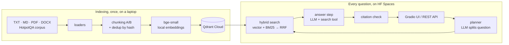

# AI Investigation Engine

A retrieval-augmented investigation system over ~60,000 documents. It splits a question into searches,
collects evidence with hybrid retrieval (vector + own BM25, merged by own Reciprocal Rank Fusion),
answers only from retrieved chunks with numbered citations, flags sources that contradict each other,
and refuses when the evidence is not there.

**Live demo:** _add the Hugging Face Space link here_ · **Evaluation:** [docs/EVALUATION.md](docs/EVALUATION.md) ·
**AI usage:** [docs/AI_USAGE.md](docs/AI_USAGE.md) · **Decisions:** [docs/decisions](docs/decisions)

## How it works



1. **Planner.** The LLM turns the question into up to 3 search queries (one per hop); the original question is always searched too.
2. **Retrieval.** Each query goes to vector search (cosine, Qdrant) and to BM25 (in memory). Rankings are fused with RRF.
3. **Answer.** Chunks are labelled `C1…Cn`. The LLM must cite labels for every claim, list contradictions, or set `insufficient_evidence`. It can call the `search_documents` tool up to 2 times if evidence is missing.
4. **Verification.** Citations to labels that were never shown are dropped; an answer left without valid citations is marked unsupported.

## Requirements coverage

| Requirement | Where |
|---|---|
| 3+ formats, text + metadata | `app/ingest/loaders.py` (TXT, MD, PDF, DOCX) |
| Two chunking strategies, compared | `app/ingest/chunking.py`, results in `docs/EVALUATION.md` |
| Deduplication, add / update / delete | `app/ingest/dedup.py`, `app/ingest/pipeline.py`, `PUT/DELETE /api/documents` |
| Vector DB + embeddings | Qdrant (`app/search/vector_store.py`), bge-small via fastembed |
| Hybrid search, own algorithm | own BM25 `app/search/bm25.py`, own RRF `app/search/hybrid.py` |
| Multi-step reasoning, citations | `app/rag/planner.py`, `app/rag/answer.py` |
| Contradictions, refusal | answer JSON + validation in `app/rag/answer.py` |
| LLM error handling | timeouts, retries with backoff and Retry-After, 503 to the client: `app/rag/llm.py`, `app/retry.py` |
| Tool calling | `search_documents` tool, `app/rag/tools.py` |
| Own evaluation, 40+ questions | `eval/` (44 questions, Recall@K, MRR, correctness, citation accuracy, abstention) |
| UI + backend | Gradio on top of FastAPI, one process |
| 50,000+ documents | HotpotQA dev distractor paragraphs + synthetic documents |
| Deployment, persistence, secrets | HF Spaces (Docker) + Qdrant Cloud; keys in Space secrets |

## Run locally

```bash
python -m venv .venv && source .venv/bin/activate      # Windows: .venv\Scripts\activate
pip install -r requirements.txt
cp .env.example .env                                     # add LLM_API_KEY; QDRANT_URL empty = local storage
python -m scripts.build_subset                           # downloads HotpotQA dev from Hugging Face (~27 MB) -> data/corpus.jsonl
python -m scripts.make_synthetic_docs                    # data/synthetic: 9 files in 4 formats
python -m scripts.index_dataset --strategy paragraph --collection documents_paragraph
uvicorn app.api.main:app --port 7860                     # UI: http://localhost:7860, API docs: /docs
pytest
```

Quick try without the full corpus: `python -m scripts.index_dataset --limit 2000`.

## Evaluation

```bash
python -m eval.run_eval build                                                        # writes eval/questions.jsonl
python -m eval.run_eval run --name vector_paragraph --collection documents_paragraph --mode vector --retrieval-only
python -m eval.run_eval run --name hybrid_paragraph --collection documents_paragraph --mode hybrid --retrieval-only
python -m eval.run_eval run --name hybrid_fixed --collection documents_fixed --mode hybrid --retrieval-only
python -m eval.run_eval run --name full_hybrid --collection documents_paragraph --mode hybrid --judge
python -m eval.run_eval compare vector_paragraph hybrid_paragraph hybrid_fixed
```

## Deploy (Hugging Face Spaces + Qdrant Cloud)

1. Create a free Qdrant Cloud cluster and put `QDRANT_URL`, `QDRANT_API_KEY` in `.env`.
2. Index locally, then copy the ready vectors to the cloud (no second embedding pass):
   `python -m scripts.copy_collection --collection documents_paragraph`
3. `hf auth login` (write token), then `python -m scripts.deploy_space --space <user>/investigation-engine`.
   The script creates a Docker Space, stores `LLM_API_KEY`, `LLM_BASE_URL`, `LLM_MODEL`, `QDRANT_URL`,
   `QDRANT_API_KEY`, `COLLECTION` as Space **secrets** and uploads the code (`upload_folder`, because Spaces
   reject binary files pushed with plain git).
4. On start the app reads all chunks from Qdrant and builds BM25 in memory, so a restart loses nothing.

## API

| Method | Path | |
|---|---|---|
| GET | `/api/health` | status and index stats |
| GET | `/api/documents` | uploaded and synthetic documents (the 66k corpus paragraphs are counted in `/api/health`) |
| POST | `/api/documents` | upload a file (multipart `file`) |
| PUT | `/api/documents/{doc_id}` | new version of a document |
| DELETE | `/api/documents/{doc_id}` | remove a document and its chunks |
| POST | `/api/search` | `{"query", "k", "mode"}` raw retrieval |
| POST | `/api/ask` | `{"question", "mode"}` full investigation |

## Privacy

Embeddings are computed locally, so indexing sends nothing outside. At question time only the retrieved
chunks (at most 12) and the question are sent to the LLM provider. Do not upload confidential documents to the public demo.

## Limitations

- Free tiers: the Space sleeps when idle (first request is slow), the LLM free tier limits requests per minute.
- BM25 lives in memory and is rebuilt after an upload or delete (a few seconds on 60k chunks).
- Contradiction detection is done by the LLM over the retrieved chunks; conflicts in documents that were not retrieved are not seen.
- The corpus is English; the embedding model is English-only.

## Repository map

```
app/ingest    loaders, chunking, dedup, pipeline      app/search   embeddings, Qdrant, BM25, hybrid
app/rag       llm client, prompts, tools, planner, answer loop
app/api       FastAPI                                  app/ui       Gradio
scripts/      dataset subset, synthetic docs, indexing eval/        questions, metrics, runner
tests/        pytest, external services mocked         docs/        decisions, evaluation, AI usage
```
